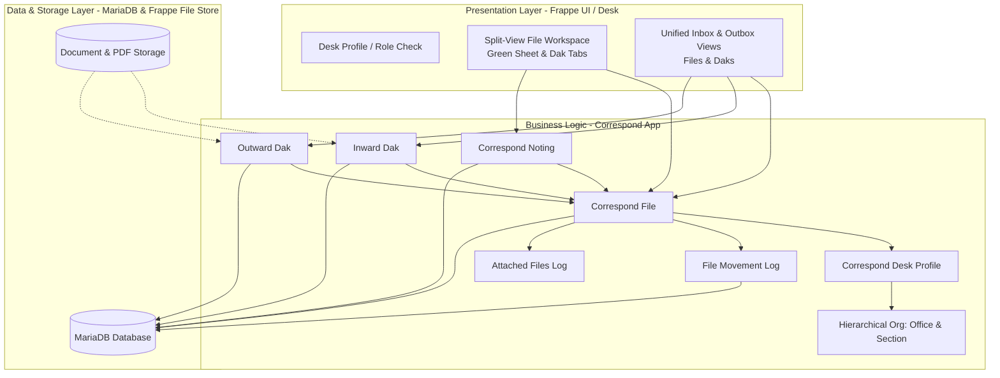
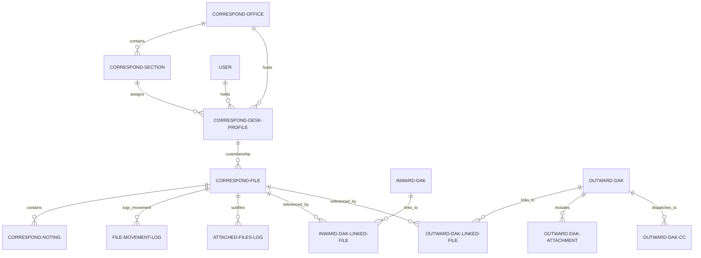

# Blueprint: Correspond (eOffice-aligned File & Dak Management System)

## 1. Executive Summary & Vision

**Correspond** is an open-source, web-based digital workplace and electronic file lifecycle management application built on the **Frappe Framework**. Designed in the pattern of the Government of India's **eOffice (eFile & Dak/Receipt Management System)** developed by the National Informatics Centre (NIC), **Correspond** transitions bureaucratic, public sector, and enterprise paper workflows into a modern, transparent, accountable, and paperless operational model.

The system mirrors the Central Secretariat Manual of Office Procedure (CSMOP) principles:
- **Receipt / Dak Processing:** Diarization, classification, tagging, tracking, inward receipts, and outward correspondence.
- **Electronic File Processing:** Split-view workspace featuring green-sheet notings on the left and correspondence / reference annexures on the right.
- **Seat/Desk-based Custody & Routing:** Workflows bind not merely to user credentials but to institutional "Desk Profiles" (designation, seat number, section, department, and office hierarchy).
- **Auditability & Integrity:** Immutable movement logs, historical snapshotting, and strict custodial enforcement.

---

## 2. Current Implementation Status & Progress Audit

### 2.1 Overall Completion Status: ~40% (MVP Stage)

The table below summarizes where the project currently stands against a production-grade eOffice implementation:

```
+---------------------------------------------------------------------------------------------------------+
| MODULE / COMPONENT            | MATURITY  | STATUS      | CURRENT IMPLEMENTATION SCOPE                  |
+-------------------------------+-----------+-------------+-----------------------------------------------+
| 1. Desk & Org Structure       | High      | Implemented | Desk Profiles, hierarchical naming, lockouts  |
| 2. File Numbering & Routing   | High      | Implemented | CSMOP autonaming, forward, send back, custody |
| 3. Green Sheet Notings        | High      | Implemented | Yellow drafts, Green finalization, pagination |
| 4. Split-View Workspace       | Medium    | Implemented | Dual-pane (Green Sheet + Dak Tabs: TOC/Draft) |
| 5. Master / Sub-file Linking  | Medium    | Implemented | Attach / detach child files with movement log |
| 6. Inward Dak (Receipts)      | Low-Med   | Partial     | Basic entry form & linking; no OCR or QR/Bar  |
| 7. Outward Dak (Dispatch)     | Low-Med   | Partial     | Basic form, external email queue, CC child tab|
| 8. Workflow Agility (Pull/Park| None      | Pending     | No Pull Back, No Park File, No Link Officer   |
| 9. Referencing & Flagging     | Low       | Partial     | Basic internal link check; no Flag A-Z slips  |
| 10. Archival & Retention      | None      | Pending     | Basic delete check; no CSMOP retention/weeding|
| 11. Security & Signatures     | Low       | Basic HTML  | Uploaded signature image only; DSC/eSign deferred|
| 12. Automated Test Coverage   | None      | Pending     | Test scaffolds generated but unwritten        |
+---------------------------------------------------------------------------------------------------------+
```

### 2.2 Deep Dive: What is Already Built & Working

1. **Desk Profile Model (`Correspond Desk Profile`)**:
   - Institutional seat identification decoupled from raw user logins.
   - Dynamic autonaming: `<Office>/<Dept>/<Section>/<Designation>-<SeatNo>`.
   - Security controls: Non-admins cannot create desk profiles and can only edit their signature block.
   - Deletion protection if any file movement history exists for that desk.

2. **Electronic File Lifecycle (`Correspond File`)**:
   - Central Secretariat autonaming convention: `<Dept>/<Office>/<Section>/<YYYY>/<Sequence>`.
   - Custody gating: Strict permissions where only the active desk holder can edit or forward.
   - Immutability: Subject and description freeze permanently once the file has been routed.
   - Historical Snapshot isolation: Historical viewers only see file data and notings up to their `cutoff_date` (the exact timestamp when the file left their desk).
   - Bulk File Forwarding: Capable of forwarding multiple files from inbox in a single action.

3. **Green Sheet & Yellow Notes (`Correspond Noting`)**:
   - Two-stage noting lifecycle: Working drafts remain "Yellow Drafts", and once marked "Green" they automatically submit (`docstatus = 1`) upon file forwarding, becoming legally permanent.
   - Server-side pagination (5 notes per page) and previous notes tab in split-view.
   - User profile modal displaying historical desk title of note authors.

4. **Master and Sub-file Operations**:
   - Ability to attach sub-files to a master file and forward them collectively.
   - Detailed detachment logging maintaining custodial integrity.

5. **Inward & Outward Dak (Receipt & Dispatch)**:
   - Inward Dak logging (receipt mode, external reference number, date, subject).
   - Outward Dak creation with external recipient emailing via Frappe email queue (`frappe.enqueue`) and CC list distribution.
   - Standard reports: `File Inbox`, `File Outbox`, `Dak Inbox`, `Dak Outbox`.

### 2.3 Critical Technical Debt & Immediate Gaps in the Current Codebase

1. **Test Coverage Deficit:**
   - All test files (`test_correspond_file.py`, `test_inward_dak.py`, `test_correspond_desk_profile.py`, etc.) currently contain only placeholder `pass` statements without automated test cases.
2. **Missing Pull Back & Park File Operations:**
   - If an officer makes a mistake while routing, they cannot "Pull Back" even if the recipient has not opened the file.
   - Files waiting for long-term external responses clutter the active inbox because "Park File" state is absent.
3. **Drafting Formats & Central Registry:**
   - Outward communications lack standard Government of India letter formats (OM, D.O. Letter, Sanction Order) and central dispatch numbering registers.
4. **Physical Docketing & Scanning:**
   - Inward receipts lack barcode/QR docket label printing and OCR parsing.
5. **Flagging Slips:**
   - Lack of visual alphanumeric flag tags (Flag 'A' to 'Z') on attachments and notings.

---

## 3. System Architecture & Domain Model

### 3.1 Architectural Diagram



---

### 3.2 Core DocTypes & Entity Relationships



---

## 4. UI/UX Workflow: The eOffice-Style Workspace

Correspond includes a specialized dual-pane interface:

```
+-----------------------------------------------------------------------------------------+
| FILE HEADER: File No: DE/GEN/GENL/2026/0012 | Subject: Procurement of Workstations       |
| Status: Active | Custodian: Desk Asst-1 (John Doe) | Office: Head Office                |
+-------------------------------------------+---------------------------------------------+
| LEFT PANE: Green Sheet (Notings)          | RIGHT PANE: Correspondence & Referencing    |
| [Add Note] [Forward File] [Send Back]     | Tabs: [ ToC ] [ Previous Notings ] [ Drafts]|
|                                           |                                             |
| Note #1 (Final - Submitted)               | ToC:                                        |
| From: Section Officer (Jane Smith)        | - Inward Dak #102: Proposal from Vendor A   |
| Date: 12-08-2026 10:15                    | - Outward Dak #45: Clarification Letter     |
| "The proposal has been reviewed..."       |                                             |
|                                           | Drafts:                                     |
| Note #2 (Yellow Draft - In Progress)      | - Draft Outward: Sanction Order (Drafting)  |
| "Financial concurrence is required..."    |                                             |
| [Mark Green] [Edit Note]                  | [ Add Inward Dak ] [ Create Outward Dak ]   |
+-------------------------------------------+---------------------------------------------+
```

---

## 5. GAP Analysis: Correspond vs. NIC eOffice (v7.x)

| Functional Domain | NIC eOffice Feature Specification | Current Status in Correspond | Gap Severity | Action Plan |
| :--- | :--- | :--- | :--- | :--- |
| **Workflow Controls** | Pull Back (recall unread files), Park File (hold with timer/reason), Link Officer (leave delegation). | Forward, Send Back, Bulk Forward, Attach/Detach. | **High** | **Sprint 1 & 3:** Implement Pull Back, Park, and Link Officer delegation engine. |
| **Referencing & Tagging** | Alphanumeric Flag slips (Flag 'A'-'Z') linked directly to specific PDF pages/paras. | Basic link check in noting editor; no flag slips. | **High** | **Sprint 1:** Add Flag Slips and interactive quick-jump in Split-View. |
| **Drafting (DFA)** | Government letter templates (OM, D.O., Circular, Sanction Order), formal approval, dispatch register. | Outward Dak with basic text editor and email queue. | **High** | **Sprint 2:** Build DFA Template Engine and Central Dispatch Register. |
| **Diarization & Ingestion** | Batch scan ingest, OCR indexing, duplicate check, QR barcode sticker generation. | Manual Inward Dak form with basic file attach. | **High** | **Sprint 3:** Add barcode label printing, duplicate detection, and OCR queue. |
| **File Retention & Archival** | CSMOP Record Categorization (Class A, B, C-10, C-3), retention timers, electronic record room, weeding. | Deletion check only based on movement history. | **High** | **Sprint 4:** Build Electronic Record Room and Weeding Destruction Register. |
| **Audit & Watermarking** | Dynamic security watermarking on view/export with user identity and timestamp. | Movement log records routing; no document watermarking. | **Medium** | **Sprint 1:** Add PDF watermarking on view and download. |
| **Digital Signatures & DSC** | PKI-based USB Token DSC & Aadhaar eSign (IT Act 2000). | Uploaded image signature block. | *Deferred* | **On Hold** per project steering committee decision. |

---

## 6. Implementation Roadmap & Execution Sprints

```mermaid
timeline
    title Execution Roadmap (Excluding DSC/eSign)
    section Sprint 1 (Weeks 1-4) : Pull Back Functionality : Park File & Hold Engine : Alphanumeric Flagging (Flag A-Z) : Security Watermarking
    section Sprint 2 (Weeks 5-8) : Government DFA Templates (OM, DO, Sanction) : Formal Approval Lifecycle : Central Dispatch Register
    section Sprint 3 (Weeks 9-12) : Link Officer Delegation Engine : Diarization QR/Barcode Generator : Duplicate Receipt Detection & OCR : VIP & Parliament SLA Tracker
    section Sprint 4 (Weeks 13-16) : CSMOP Record Retention (Cat A/B/C) : Electronic Record Room & Weeding : Executive TAT & Pendency Dashboards : eExchange Inter-Instance Sync
```

Refer to the accompanying [implementation_plan.md](file:///home/odoo_server/apps/frappe-bench/apps/correspond/implementation_plan.md) for detailed task breakdowns, schema additions, and delivery checklists.
