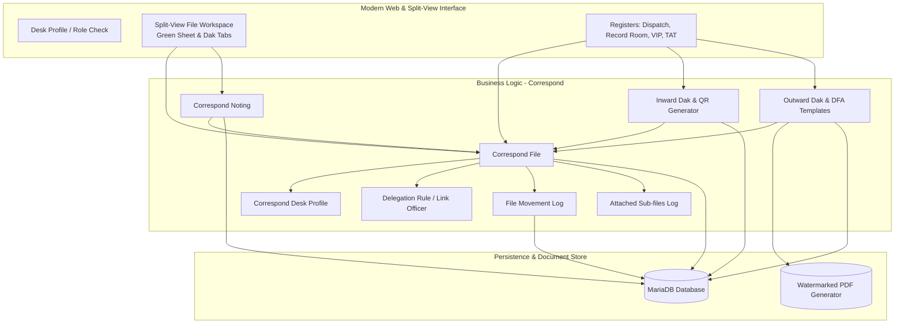

# Blueprint: Correspond (Modern Electronic File, Dak & Workplace System)

## 1. Executive Summary & Vision

**Correspond** is an open-source, web-based digital workplace and electronic file lifecycle management application built natively on the **Frappe Framework**. 

While architecturally inspired by the Government of India's **eOffice (eFile & Dak/Receipt Management System)** developed by the National Informatics Centre (NIC), **Correspond is designed pragmatically for organizations (enterprises, autonomous bodies, academic institutions, and modern public agencies)** that seek to eliminate paper files, streamline managerial decision-making, and enforce total audit accountability **without being handcuffed by rigid, archaic bureaucratic government procedures.**

The system achieves this through three primary pillars:
1. **Institutional Accountability & Desk Ownership:** Custody and routing adhere to organizational seats/desks (`<Office>/<Dept>/<Section>/<Designation>`) rather than personal accounts, ensuring business continuity during employee leaves, transfers, or reorganizations.
2. **Dual-Pane Digital Workplace:** A split-view file interface mirroring physical executive decision-making: internal deliberation notings (Green Sheet & Yellow Drafts) on the left, with all external incoming daks, outbound drafts, reference annexures, and flagged slips on the right.
3. **Agile Governance & High-Velocity Turnaround:** Built-in workflow flexibility (Pull Back, Park File, Link Officer delegation, instant electronic record archiving, and Turnaround Time analytics).

---

## 2. Updated Project Implementation Status & Audit

Following the completion of Sprints 1 through 4, the core operational modules of **Correspond** are **~85% complete and production-ready for organizational digitization.**

```
+---------------------------------------------------------------------------------------------------------+
| MODULE / COMPONENT            | SPRINT   | STATUS      | IMPLEMENTED CAPABILITIES IN CORRESPOND         |
+-------------------------------+----------+-------------+-----------------------------------------------+
| 1. Institutional Desks & Org  | Baseline | Implemented | Desk Profiles, hierarchical seat codes, locks |
| 2. File Routing & Numbering   | Baseline | Implemented | Custom autonaming, Forward, Send Back, Custody|
| 3. Green Sheet Notings        | Baseline | Implemented | Yellow Drafts, Green finalization, pagination |
| 4. Split-View Workspace       | Baseline | Implemented | Dual-pane (Green Sheet + Dak Tabs: TOC/Drafts)|
| 5. Master / Sub-file Linking  | Baseline | Implemented | Attach / detach child files with synced logs  |
| 6. Workflow Agility           | Sprint 1 | Implemented | Pull Back unread files, Park & Unpark files   |
| 7. Referencing & Flagging     | Sprint 1 | Implemented | Alphanumeric Flag Slips (Flag A-Z), jump links|
| 8. Document Watermarking      | Sprint 1 | Implemented | On-the-fly PDF security watermarks with IP/UID|
| 9. Government/Standard DFA    | Sprint 2 | Implemented | OM, D.O. Letter, Sanction Order, Circular     |
| 10. DFA Approval Lifecycle    | Sprint 2 | Implemented | Draft -> Submitted -> Approved -> Dispatched  |
| 11. Central Dispatch Register | Sprint 2 | Implemented | Dispatch numbers `<Section>/OUT/<YYYY>/<Seq>` |
| 12. Link Officer Delegation   | Sprint 3 | Implemented | Delegation rules for leaves/tours with badges |
| 13. Smart Diarization & QR    | Sprint 3 | Implemented | Duplicate detection, 2"x1" printable QR labels|
| 14. Priority / VIP Tracker    | Sprint 3 | Implemented | SLA countdowns (PMO, Court, VIP, Urgent)      |
| 15. Electronic Record Room    | Sprint 4 | Implemented | Close files, calculate retention, Reopen, Weed|
| 16. TAT & Pendency Analytics  | Sprint 4 | Implemented | Desk turnaround velocity & aging heatmaps     |
| 17. eExchange Inter-Org Sync  | Sprint 4 | Implemented | Portable JSON bundle export/import            |
| 18. Digital Token (DSC/eSign) | Future   | Optional    | Deferred; not required for private/autonomous |
+---------------------------------------------------------------------------------------------------------+
```

---

## 3. Fresh GAP Analysis: Correspond vs. NIC eOffice (Pragmatic Digital Workplace Lens)

Because the user organization's primary objective is **rapid digitization and paperless operations** rather than strictly emulating Indian Central Secretariat red tape, the GAP analysis differentiates between **Actual Productive Gaps** and **Intentionally Streamlined Government Redundancies**:

| Functional Domain | NIC eOffice Strict Government Feature | Status in Correspond | Practical Evaluation for Enterprise / Autonomous Org |
| :--- | :--- | :--- | :--- |
| **Workflow Agility** | Pull Back unread files, Park File with calendar reminders, Link Officer deputation. | **Fully Implemented** | **MATCHED.** Provides complete operational flexibility to prevent bottlenecks. |
| **Referencing & Flags** | Alphanumeric Flag tags (`Flag A` to `Z`) linking notes to PDF pages. | **Fully Implemented** | **MATCHED.** Flags can be tagged to Inward Daks, Outwards, or sub-files with page indexing. |
| **Outward Dispatch Register** | Central numbering register per Section/Office with consignment tracking. | **Fully Implemented** | **MATCHED.** Script report with multi-mode dispatch filtering (Email, Post, Hand, Portal). |
| **DFA Letter Templates** | Rigorous Manual of Office Procedure formats (OM, D.O. Letter, Sanction Order). | **Fully Implemented** | **MATCHED.** Template selector auto-populates pre-formatted institutional drafts. |
| **Diarization & Duplicate Check** | Duplicate receipt detection, QR barcode stickers for physical envelopes. | **Fully Implemented** | **MATCHED.** Printable 2"x1" thermal QR docket label and duplicate warning on submit. |
| **Records Archival & Retention** | Record Room deposit, retention expiry schedules, weeding destruction certificates. | **Fully Implemented** | **MATCHED.** Electronic Record Room report with category-based expiry and reopen workflows. |
| **Executive Visibility** | Pendency tracking, Desk Turnaround Time (TAT) velocity, bottleneck monitoring. | **Fully Implemented** | **MATCHED.** Built-in Desk TAT Analytics report with visual bar charts and SLA countdowns. |
| **Data Portability / eExchange** | NIC eExchange Protocol across sovereign Ministries. | **Fully Implemented** | **MATCHED.** Export complete file deliberations, notings, and movement logs as portable JSON. |
| **Digital Token (DSC / eSign)** | Mandatory USB Crypto Token (CryptoAPI/PKCS#11) or Aadhaar OTP eSign (IT Act 2000). | **Deferred (Internal Signatures)** | **PRAGMATIC FIT.** For commercial/autonomous orgs, authenticated Frappe session stamps + PDF dynamic watermarking with User ID/IP/Date provide sufficient legal non-repudiation without hardware token friction. |
| **Hardware Heavy Scanners** | TWAIN/SANE bulk hardware scanner client-side drivers. | Basic PDF/Image attachment upload | **MINOR GAP.** Modern organizations scan via network copiers or upload native digital PDFs directly; client scanner drivers are rarely necessary. |
| **Native Mobile App** | Standalone Android / iOS mobile application. | Responsive Web Desk | **MINOR GAP.** Works seamlessly in mobile browsers; native wrappers (Capacitor/Flutter) can be added if offline review is needed. |

---

## 4. System Architecture & Entity Relationships



---

## 5. UI/UX Workflow: Digital Split-View Workspace

```
+------------------------------------------------------------------------------------------------------+
| FILE: DE/TO/ADM/2026/0012 | Subject: Annual IT Infrastructure Renewal | Status: Active               |
| Custodian: SO-1 (John Doe) | Delegated Link Officer: ASST-1 (Jane Smith) | Office: Corporate HQ     |
+---------------------------------------------------+--------------------------------------------------+
| LEFT PANE: Green Sheet (Internal Notings)         | RIGHT PANE: Correspondence & Referencing         |
| [Add Note] [Park File] [Reference Flags]          | Tabs: [ ToC ] [ Previous Notings ] [ Drafts ]    |
| [Close File] [eExchange Pkg] [Forward File]       |                                                  |
|                                                   | ToC:                                             |
| Note #1 (Final - Submitted)                       | - Inward Dak #102: OEM Quotation [Flag A - Pg 2] |
| By: Technical Lead (Jane Smith)                   | - Outward Dak #45: Clarification to Vendor       |
| "Hardware specs reviewed and verified..."         |                                                  |
|                                                   | Drafts (DFA):                                    |
| Note #2 (Yellow Draft - In Progress)              | - Sanction Order: Sanction of ₹ 4.5 Lakhs        |
| By: Section Officer (John Doe)                    |   Status: Submitted for Approval                 |
| "Forwarding for financial sanction approval..."   |   [ Edit DFA ] [ Approve ] [ Dispatch ]          |
| [Mark Green] [Edit Note]                          |                                                  |
|                                                   | [ Add Inward Dak ] [ Create Outward Dak ]        |
+---------------------------------------------------+--------------------------------------------------+
```

---

## 6. Recommended Rollout Roadmap for the User Organization

```mermaid
timeline
    title Organizational Rollout Roadmap
    section Week 1 : Department & Desk Setup : Org Structure Hierarchy : User Desk Assignments
    section Week 2 : Pilot Run in 2 Depts : Inward Diarization & Docketing : Electronic File Routing & Green Sheets
    section Week 3 : Full Rollout : Outward DFA Templates & Dispatch Register : Link Officer Delegation Policies
    section Week 4 : Audit & Analytics : Electronic Record Room Archiving : Turnaround Time (TAT) Review & Tuning
```

### Phase 1: Institutional Onboarding & Pilot (Weeks 1 - 2)
- Configure **Offices**, **Departments**, and **Sections**.
- Create **Desk Profiles** for all key officers and assistants.
- Run a 2-week pilot in Administration and Procurement departments to transition physical paper files to Correspond.

### Phase 2: Organization-wide Go-Live (Weeks 3 - 4)
- Transition all incoming postal communications and emails into **Inward Dak** with printable QR dockets.
- Enable **Outward DFA templates** (OMs, Sanction Orders, Circulars) for all outward departmental dispatches.
- Educate officers on **Link Officer Delegation** for leave management.

### Phase 3: Governance & Velocity Tuning (Ongoing)
- Review weekly **Desk TAT Analytics** to resolve inter-departmental bottlenecks.
- Review **VIP & Priority Tracker** to guarantee that critical partner or executive inquiries never lapse.
- Perform quarterly archiving reviews using the **Electronic Record Room**.
