# Correspond User Manual & Operations Guide
*Modern Electronic File, Dak (Receipt) & Digital Secretariat Workplace for Frappe*

---

## Table of Contents
1. [Introduction & Architectural Concepts](#1-introduction--architectural-concepts)
   - [Core Design Philosophy](#core-design-philosophy)
   - [Desk-Based Custody vs Personal Accounts](#desk-based-custody-vs-personal-accounts)
   - [Role-Based Access Control](#role-based-access-control)
2. [Master Data & Organizational Setup](#2-master-data--organizational-setup)
   - [Correspond Office & Section](#correspond-office--section)
   - [Correspond Desk Profiles & Seat Numbering](#correspond-desk-profiles--seat-numbering)
   - [Link Officer & Delegation Rules](#link-officer--delegation-rules)
3. [The Dual-Pane Split-View Workspace](#3-the-dual-pane-split-view-workspace)
   - [Workspace Layout Overview](#workspace-layout-overview)
   - [Left Pane: Green Sheet & Internal Notings](#left-pane-green-sheet--internal-notings)
   - [Right Pane: Correspondence, Daks & Reference Annexures](#right-pane-correspondence-daks--reference-annexures)
4. [Electronic File Operations](#4-electronic-file-operations)
   - [Creating a New File & Autonaming](#creating-a-new-file--autonaming)
   - [Drafting Notes: Yellow Notes vs Green Finalization](#drafting-notes-yellow-notes-vs-green-finalization)
   - [Forwarding & Sending Back Files](#forwarding--sending-back-files)
   - [Pull Back (Accidental Dispatch Recall)](#pull-back-accidental-dispatch-recall)
   - [Parking & Unparking Files](#parking--unparking-files)
   - [Alphanumeric Referencing & Flag Slips (Flag A–Z)](#alphanumeric-referencing--flag-slips-flag-a-z)
   - [Master & Sub-File Linking with History Snapshots](#master--sub-file-linking-with-history-snapshots)
5. [Inward Dak (Receipt) Management](#5-inward-dak-receipt-management)
   - [Diarizing Incoming Mail, Letters & Communications](#diarizing-incoming-mail-letters--communications)
   - [Duplicate Receipt Detection](#duplicate-receipt-detection)
   - [VIP, Court Notice & PMO SLA Tracking](#vip-court-notice--pmo-sla-tracking)
   - [2"x1" Thermal QR Docket Barcode Label Printing](#2x1-thermal-qr-docket-barcode-label-printing)
6. [Outward Dak & Draft for Approval (DFA)](#6-outward-dak--draft-for-approval-dfa)
   - [Standard Government DFA Templates](#standard-government-dfa-templates)
   - [Multi-Stage Approval Lifecycle](#multi-stage-approval-lifecycle)
   - [Central Dispatch Register Numbering](#central-dispatch-register-numbering)
   - [Consignment Tracking & Email Dispatch](#consignment-tracking--email-dispatch)
7. [Security & Document Governance](#7-security--document-governance)
   - [Dynamic Server-Side PDF Watermarking](#dynamic-server-side-pdf-watermarking)
   - [Desk-Level Custodial Lockouts](#desk-level-custodial-lockouts)
8. [Electronic Record Room & Archival Lifecycle](#8-electronic-record-room--archival-lifecycle)
   - [CSMOP Retention Schedules (Category A / B / C)](#csmop-retention-schedules-category-a--b--c)
   - [Closing & Depositing Files in the Record Room](#closing--depositing-files-in-the-record-room)
   - [Reopening Closed Files](#reopening-closed-files)
   - [Weeding Out & Destruction Certificates](#weeding-out--destruction-certificates)
9. [eExchange Federation Protocol](#9-eexchange-federation-protocol)
   - [Exporting Portable Deliberation Packages](#exporting-portable-deliberation-packages)
10. [Executive Analytics & Registers](#10-executive-analytics--registers)
    - [File Inbox & Outbox](#file-inbox--outbox)
    - [Desk Turnaround Time (TAT) & Pendency Analytics](#desk-turnaround-time-tat--pendency-analytics)
    - [Central Dispatch Register](#central-dispatch-register)
    - [VIP & Priority Reference Tracker](#vip--priority-reference-tracker)
    - [Electronic Record Room Register](#electronic-record-room-register)

---

## 1. Introduction & Architectural Concepts

### Core Design Philosophy
**Correspond** is a native **Frappe Framework** electronic decision and document workflow system. Architecturally inspired by the Government of India's **eOffice (eFile & Dak/Receipt Management System)** developed by the National Informatics Centre (NIC), **Correspond** eliminates paper files, streamlines inter-departmental decision-making, and guarantees complete audit accountability.

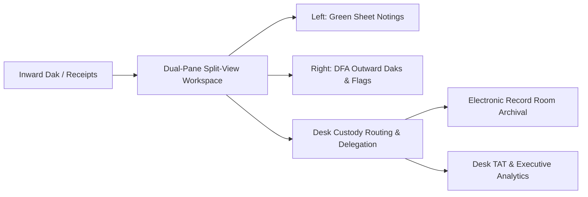

### Desk-Based Custody vs Personal Accounts
In traditional enterprise applications, documents belong to personal user accounts. When an employee is absent, transfers, or resigns, work stalls. 

In **Correspond**, files and communications belong to an **Institutional Desk Profile** formatted as:
$$\text{Desk Code} = \frac{\text{Office}}{\text{Department}}{\text{Section}}{\text{Designation - Seat Number}}$$
*Example:* `HQ/Accounts/Audit-Cell/Senior-Auditor-1`

- Routing transfers file custody between **Desks**, not individual users.
- A user assigned to a desk inherits all custody and actions of that seat.
- If a user is on tour or leave, a **Link Officer Delegation Rule** transfers temporary desk authority without password sharing.

### Role-Based Access Control
| Role Name | Scope & Authority |
| :--- | :--- |
| **Correspond User** | Regular officer or assistant. Views inbox/outbox, adds notings, drafts DFAs, forwards files held at their assigned desk. |
| **Correspond Registry Clerk** | Central registry staff. Diarizes inward mail, generates QR docket stickers, dispatches outward mail, logs postal consignments. |
| **System Manager** | Administrator. Configures Offices, Sections, Desks, Delegation Rules, and approves file destruction in the Record Room. |

---

## 2. Master Data & Organizational Setup

### Correspond Office & Section
Before creating desks or routing files, define the institutional hierarchy:
1. Navigate to **Correspond > Correspond Office**:
   - `Office Name`: e.g., *Headquarters Central Secretariat*
   - `Office Abbr`: e.g., *HQ* (Used as root in file autonaming).
2. Navigate to **Correspond > Correspond Section**:
   - `Section Name`: e.g., *Administration & Establishment*
   - `Section Abbr`: e.g., *ADM*
   - `Department`: Link to standard Frappe `Department`.

### Correspond Desk Profiles & Seat Numbering
Navigate to **Correspond > Correspond Desk Profile > New**:

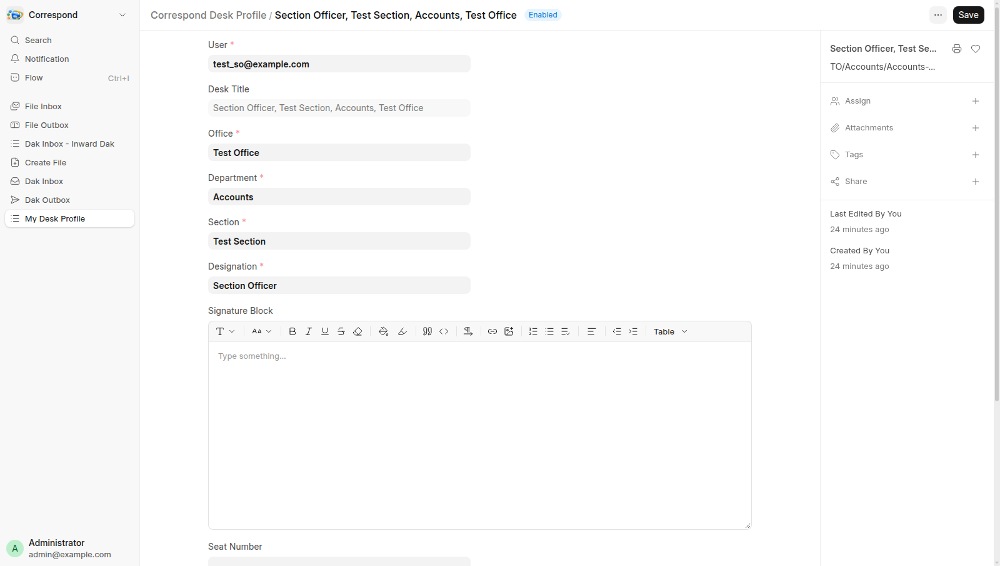

> [!NOTE]
> Each user can only have **one active primary desk profile** at a time. The signature block is automatically appended to finalized Green Sheet notes.

### Link Officer & Delegation Rules
To ensure continuity when an officer is on leave or official tour:
1. Navigate to **Correspond > Correspond Delegation Rule > New**.
2. Select the **Primary Desk** (e.g., `HQ/Admin/Director`).
3. Select the **Delegate Desk** (e.g., `HQ/Admin/Deputy Director`).
4. Set `From Date`, `To Date`, and `Delegation Reason`.
5. Check `Is Active`.

```mermaid
flowchart LR
    A[Incoming File for Primary Desk] --> B{Active Delegation Rule?}
    B -- Yes --> C[Appears in Delegate Officer's Inbox with [Delegated] Badge]
    B -- No --> D[Normal Delivery to Primary Desk Inbox]
    C --> E[Actions recorded as: "Acted on behalf of Primary Desk"]
```

---

## 3. The Dual-Pane Split-View Workspace

Opening any **Correspond File** loads the full-screen dual-pane digital workplace replicating physical secretariat decision-making.

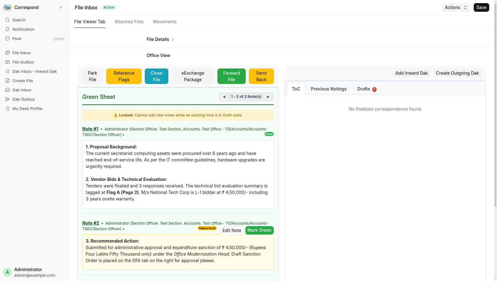

### Left Pane: Green Sheet & Internal Notings
- **Green Sheet**: Permanent internal departmental minutes and deliberations.
- **Note Navigation**: Quick `<` and `>` pagination across voluminous historic notes.
- **Author Identity Badges**: Clicking on an author's name opens their institutional profile, current designation, and contact details.

### Right Pane: Correspondence, Daks & Reference Annexures
Contains three functional tabs:
1. **ToC (Table of Contents)**: All finalized incoming receipts (Inward Daks) and finalized outward letters attached to the file.
2. **Previous Notings**: Read-only chronological digest of prior minutes for reference during drafting.
3. **Drafts**: Active Drafts for Approval (DFAs) pending supervisor review, red-line edits, or dispatch.

---

## 4. Electronic File Operations

### Creating a New File & Autonaming
1. Click **New Correspond File**.
2. Enter the **Subject** and **Description**.
3. The system generates an official hierarchical file number:
   $$\text{File No} = \text{DeptAbbr}/\text{OfficeAbbr}/\text{SectionAbbr}/\text{YYYY}/\text{Serial}$$
   *Example:* `AD/HQ/EST/2026/00042`

### Drafting Notes: Yellow Notes vs Green Finalization
Correspond uses the traditional secretariat **Yellow / Green Noting** convention:

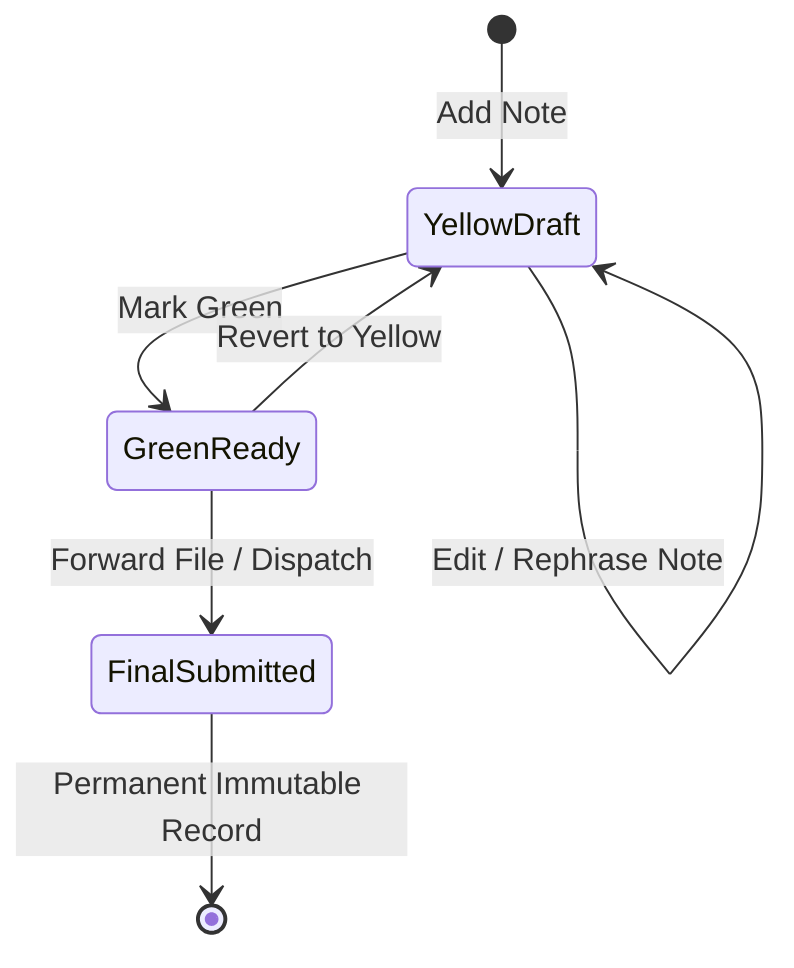

1. **Yellow Draft (Drafting Mode)**:
   - Click `Add Note`. Enter text using the rich-text editor.
   - Note appears highlighted in soft yellow. It can be freely edited, rephrased, or discarded.
   - *Constraint:* While a draft note exists, adding subsequent notes is locked.
2. **Mark Green (Finalization)**:
   - Click `Mark Green`. Note background switches to light green, indicating readiness.
   - When the file is forwarded to another desk, the note converts to an **Immutable Final Green Note** stamped with the officer's digital signature block.

### Forwarding & Sending Back Files
1. **Forward File**:
   - Click `Forward File` on the Green Sheet action bar.
   - Select destination **Recipient Desk Profile** (filtered to active desks).
   - Enter optional **Remarks / Instructions**.
   - Custody immediately transfers to the recipient desk.
2. **Send Back**:
   - Quick one-click action to return the file to the immediately preceding desk in the movement log.

### Pull Back (Accidental Dispatch Recall)
If you forward a file by mistake or forgot to attach a document, you can instantly recall it:

```
+----------------------------------------------------------------------------------+
| SCREEN: Pull Back Confirmation Modal                                             |
+----------------------------------------------------------------------------------+
| ⚠️ Recall File to Your Desk                                                      |
|                                                                                  |
| File Number: HQ/ADM/2026/00142                                                   |
| Dispatched To: HQ/Finance/Audit-Officer-1                                        |
| Forwarded On: 18-Nov-2026 11:30 AM                                               |
| Status at Recipient: UNOPENED (Eligible for Pull Back)                           |
|                                                                                  |
| Reason for Recall (Mandatory):                                                   |
| [ Forgot to attach revised vendor quotation Flag C...                          ] |
|                                                                                  |
|                              [ Cancel ]  [ Confirm Pull Back ]                   |
+----------------------------------------------------------------------------------+
```

> [!IMPORTANT]
> **Pull Back Eligibility Rules:**
> - Eligible **only** if the recipient desk has not yet opened/viewed the file.
> - Eligible **only** if no subsequent notes have been drafted.
> - Custody is immediately returned to your desk, and an audit entry `Action: Pulled Back` is permanently recorded in the movement log.

### Parking & Unparking Files
When a file is awaiting external dependency (e.g., an audit inquiry, court judgment, or government notification):
1. Click `Park File` on the action bar.
2. Enter the **Park Reason** and an optional **Park Until Date**.
3. Status switches to `Parked`. The file remains safely in your custody but is moved from the active Inbox to the **Parked Files** view so active pending TAT counters are paused.
4. When ready, click `Resume / Unpark File`.

### Alphanumeric Referencing & Flag Slips (Flag A–Z)
Reference external annexures, daks, and attached sub-files directly in your minutes:

```
+----------------------------------------------------------------------------------+
| SCREEN: Manage Referencing Flags                                                 |
+----------------------------------------------------------------------------------+
| Flag Letter: [ Flag A       ▼ ]                                                  |
| Reference Document Type: [ Inward Dak                                         ▼ ]|
| Document Name / ID: [ DAK-2026-00102                                          ▼ ]|
| Target Page Number: [ 3 ]                                                        |
| Remarks / Description: [ OEM Technical Specifications Sheet                     ]|
|                                                                                  |
|                                                   [ Save Reference Flag ]        |
|----------------------------------------------------------------------------------|
| Active Reference Flags on this File:                                             |
| • FLAG A ➔ Inward Dak #102 (Page 3) - OEM Technical Specifications Sheet         |
| • FLAG B ➔ Correspond File #0089 (Page 1) - Previous Financial Sanction Order     |
+----------------------------------------------------------------------------------+
```

In the Green Sheet, mentioning `@Flag A` creates a clickable jump link that immediately displays the referenced document in the right pane scrolled to the designated page.

### Master & Sub-File Linking with History Snapshots
For complex policy matters requiring historical reference:
1. Attach child files as **Sub-files** to the **Master File**.
2. When attached, the master file receives a complete read-only **historical snapshot** of the sub-file's deliberations.
3. When the master file is forwarded, all attached sub-files move in custody alongside it, ensuring related files never become separated.

---

## 5. Inward Dak (Receipt) Management

### Diarizing Incoming Mail, Letters & Communications
Navigate to **Correspond > Inward Dak > New**:
1. Select `Receipt Mode`: *Email, Speed Post, Hand Delivery, Courier, Portal*.
2. Enter `Sender Name`, `Designation`, `Sender Organization`, and `Address`.
3. Enter `External Reference Number` (letter dispatch number on the envelope) and `External Reference Date`.
4. Enter `Subject` and upload scanned attachments (PDF or images).
5. Click **Save** then **Submit** to generate the official Diarization Number (e.g., `DAK/2026/00142`).

### Duplicate Receipt Detection
If an external agency sends the same letter via email and registered post, Correspond automatically protects the register:
- If a receipt with the identical `(Sender Organization + External Reference Number + Reference Date)` already exists, the system halts with:
  > `[ValidationError] Duplicate Inward Receipt: Communication with reference number 'MOF/2026/99' from 'Ministry of Finance' is already diarized as 'DAK/2026/00084'.`

### VIP, Court Notice & PMO SLA Tracking
Check `Is VIP Reference` to activate strict statutory turnaround deadlines:

| VIP Category | Default SLA Turnaround | Escalation Severity |
| :--- | :---: | :--- |
| **PMO Reference** | **3 Days** | Critical / Immediate SMS & Email alerts |
| **Cabinet Secretariat** | **3 Days** | Critical |
| **Parliament Question (Starred/Unstarred)** | **2 Days** | High Emergency |
| **Court Notice / Summons** | **5 Days** | High Legal Risk |
| **MP / MLA Reference** | **7 Days** | Supervisory Desk Tracking |

### 2"x1" Thermal QR Docket Barcode Label Printing
Once submitted, physical mail room staff print adhesive thermal stickers for incoming envelopes:
- Click **Print Docket Label** on the Inward Dak form:

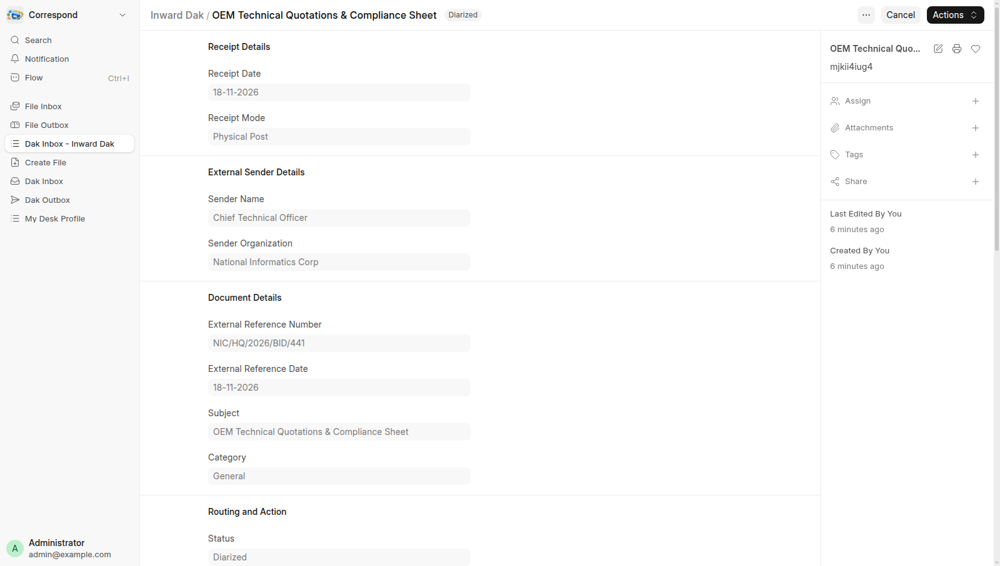

```
+----------------------------------------------------+
| GOVT E-DAK DOCKET                                  |
| DAK/HQ/2026/00142               +----------------+ |
| Date: 18-Nov-2026               | [QR BARCODE]   | |
| From: Ministry of Electronics   | Scans directly | |
| ⚠️ PMO Reference | Due: 21-Nov  | to Dak Record  | |
+---------------------------------+----------------+ |
```

Scanning this QR code with any mobile device or barcode scanner immediately pulls up the electronic record and linked files in Correspond.

---

## 6. Outward Dak & Draft for Approval (DFA)

### Standard Government DFA Templates
When preparing outbound official communications, subordinates create an **Outward Dak** directly from the file's right pane:
1. Select `DFA Type`:
   - **Office Memorandum (OM)**: Standard inter-departmental note without salutation.
   - **Demi-Official (D.O.) Letter**: Officer-to-officer personalized communication with official crest.
   - **Sanction Order**: Formal administrative and financial sanction detailing budget heads.
   - **Circular / Notification**: Broad institutional notice.
2. The rich-text editor loads standardized boilerplate headings, reference formats, and signature blocks automatically.

### Multi-Stage Approval Lifecycle

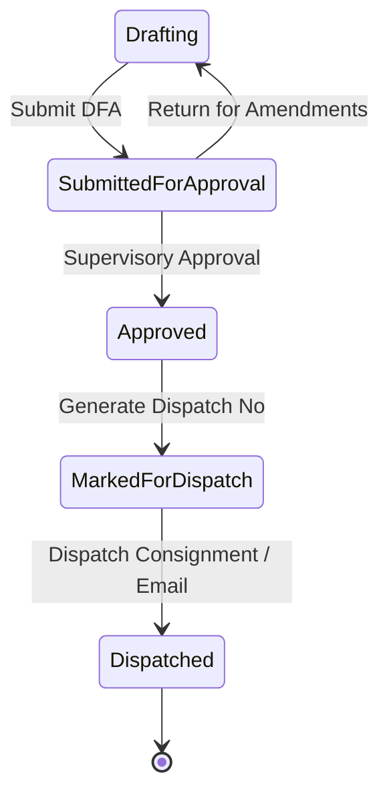

1. **Submit DFA**: Subordinate prepares the draft and clicks `Submit for Approval`.
2. **Supervisory Approval**: Superior officer reviews the draft on the file split-view and clicks `Approve DFA`. The draft freezes to prevent tampering.
3. **Mark for Dispatch**: Click `Mark for Dispatch`, select `Dispatch Mode` (*Speed Post, Email, Hand*), and enter consignment tracking numbers.

### Central Dispatch Register Numbering
Marking a DFA for dispatch automatically allocates an official sequential Central Dispatch Number:
$$\text{Dispatch Number} = \text{SectionAbbr}/\text{OUT}/\text{YYYY}/\text{Sequence}$$
*Example:* `ADM/OUT/2026/00015`

### Consignment Tracking & Email Dispatch
- For physical dispatches, postal tracking numbers (e.g., Speed Post `SP123456789IN`) are logged.
- For electronic dispatches, Correspond immediately dispatches an email with the watermarked PDF attached to the recipient and CC recipients.

---

## 7. Security & Document Governance

### Dynamic Server-Side PDF Watermarking
To prevent unauthorized leaks or camera recordings of sensitive documents:
- Every time a user downloads or views a PDF in Correspond, the server applies an on-the-fly dynamic security overlay using PyPDF & ReportLab.
- Watermark Stamp includes:
  `Downloaded by: Jane Smith (Assistant-1) | IP: 192.168.1.45 | Desk: HQ/ADM/Asst-1 | 18-Nov-2026 14:32:10`

### Desk-Level Custodial Lockouts
- A user can only edit notings or route a file if their currently active session matches the file's **Current Custodian Desk Profile**.
- Non-custodians receive a clear read-only view with an indicator showing who currently holds the file.

---

## 8. Electronic Record Room & Archival Lifecycle

### CSMOP Retention Schedules (Category A / B / C)
Files that have reached final decision are preserved according to statutory retention rules:

| Category | Classification Scope | Retention Period | Post-Expiry Action |
| :--- | :--- | :--- | :--- |
| **Category A** | Historical, constitutional, or landmark legal value | **Permanent** | Microfilmed & Archived in Central Archives |
| **Category B** | Departmental establishment, policy foundations | **25 Years** | Record Room Review prior to transfer |
| **Category C** | Routine administrative, procurement, or operational files | **3, 5, or 10 Years** | Automatic Weeding / Destruction Register |

### Closing & Depositing Files in the Record Room
1. On the Green Sheet action bar, click `Close File`.
2. Select the **Retention Category** and specify **Retention Years**.
3. System automatically calculates `Retention Due Date`:
   $$\text{Retention Due Date} = \text{Today} + \text{Retention Years}$$
4. Status transitions to `Closed`, and the file deposits into the **Electronic Record Room**.

### Reopening Closed Files
If an audit inquiry or fresh communication arrives for a closed file:
1. Locate the file in the **Electronic Record Room**.
2. Click `Reopen File`.
3. Provide a mandatory **Reopening Justification**.
4. The file returns to `Active` status with full audit logging.

### Weeding Out & Destruction Certificates
When Category C retention periods expire:
1. Files appear in the **Electronic Record Room** flagged as `Retention Expired`.
2. A System Manager or Record Room Officer reviews the file and clicks `Weed Out File`.
3. A non-deletable audit trail and **Record Destruction Certificate** is stamped in the movement log, and status changes permanently to `Archived`.

---

## 9. eExchange Federation Protocol

### Exporting Portable Deliberation Packages
To share a completed file with external autonomous agencies or sovereign ministries running Correspond:
1. Open the file and click `eExchange Package` on the action bar.
2. Correspond packages the complete deliberation into a verified JSON bundle:
   - Full file metadata & desk hierarchy
   - All finalized Green Sheet minutes with author timestamps
   - Immutable movement log audit trails
   - Referencing flag indices (`Flag A` to `Z`)
3. The bundle downloads as `<File_Number>_eExchange.json`.

---

## 10. Executive Analytics & Registers

### File Inbox & Outbox (Unified Desk Console)
To streamline day-to-day triage, Correspond provides a centralized **Correspond Desk Console** (`/app/correspond_console`):
- **4 Real-time Tabbed Queues**:
  1. `[ File Inbox ]`: Active files currently pending at your assigned desk with selection checkboxes for bulk forwarding.
  2. `[ File Outbox ]`: Files forwarded by your desk showing current custody and a dynamic `[ Pull Back ]` recall button.
  3. `[ Dak Inbox ]`: Inward receipts and communications pending review or linking to files.
  4. `[ Dak Outbox ]`: Outward communications and dispatches.

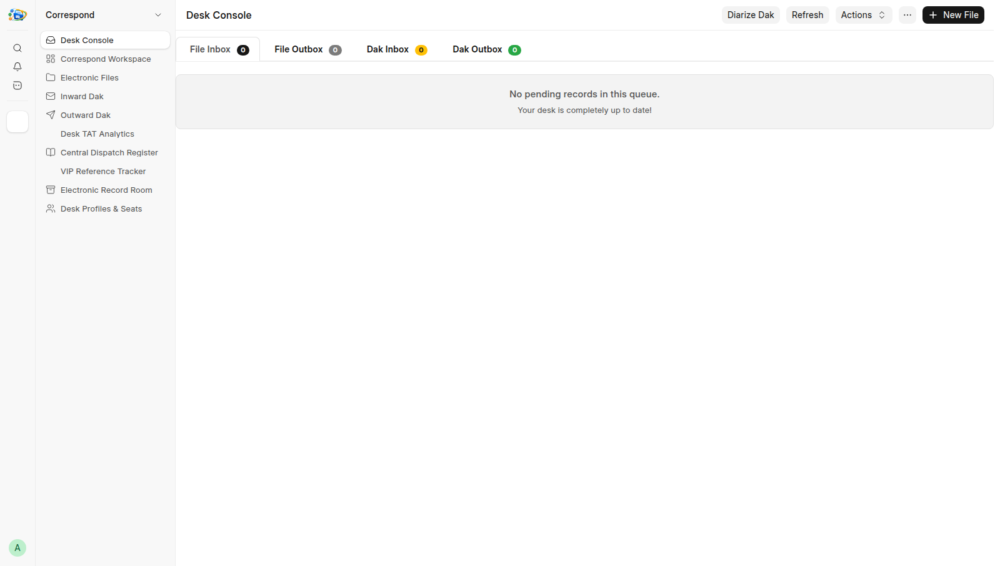

### Correspond Executive Workspace
Navigate to **Correspond** from the desk navigation rail or `/app/correspond` to access executive overview metrics and shortcuts:

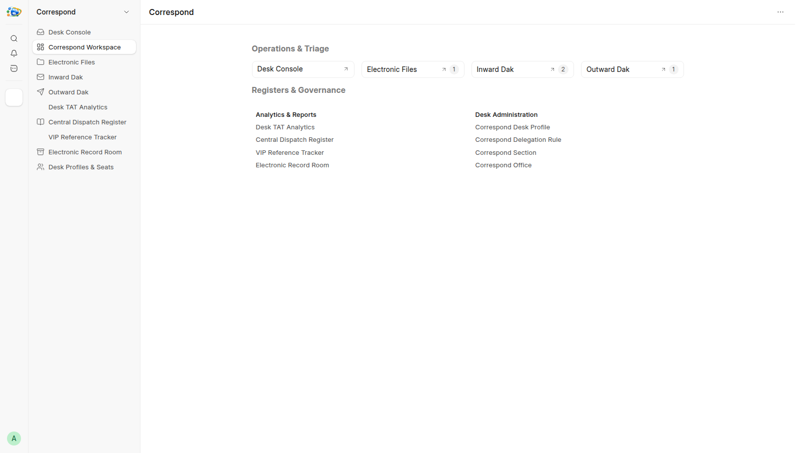

- **Number Cards**: Real-time counter of *Files at My Desk*, *VIP Daks Pending*, and *Daks Diarized Today*.
- **Operations & Triage Shortcuts**: Direct access to Desk Console, Electronic Files, Inward Dak, and Outward Dak.
- **Registers & Governance**: Direct links to Desk TAT Analytics, Central Dispatch Register, VIP Tracker, and Record Room.

### Desk Turnaround Time (TAT) & Pendency Analytics
Navigate to **Correspond > Desk TAT Analytics**:
- **Aging Buckets**: Breaks pendency down into `< 24 Hours`, `1–3 Days`, `3–7 Days`, and `> 7 Days (Overdue)`.
- **Efficiency Velocity**: Rates desks as `FAST (< 24h)`, `NORMAL (1-3 Days)`, or `SLOW (> 3 Days)`.
- **Visual Bar Charts**: Comparative bar chart of active files vs overdue bottlenecks.

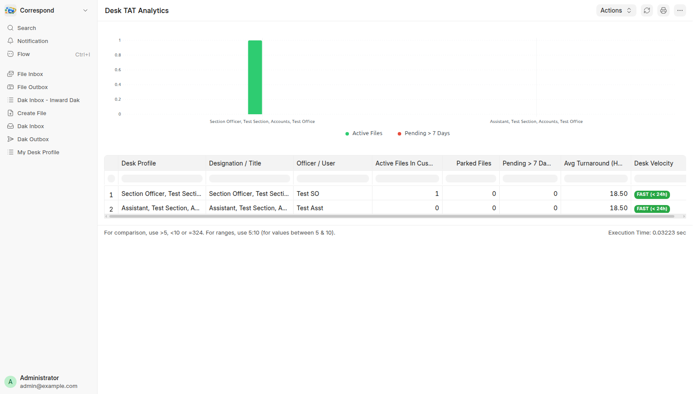

### Central Dispatch Register
Navigate to **Correspond > Dispatch Register**:
- Search and filter all outward dispatches by Section, DFA Type, Dispatch Mode (*Speed Post, Hand, Email*), and Consignment Tracking Number.

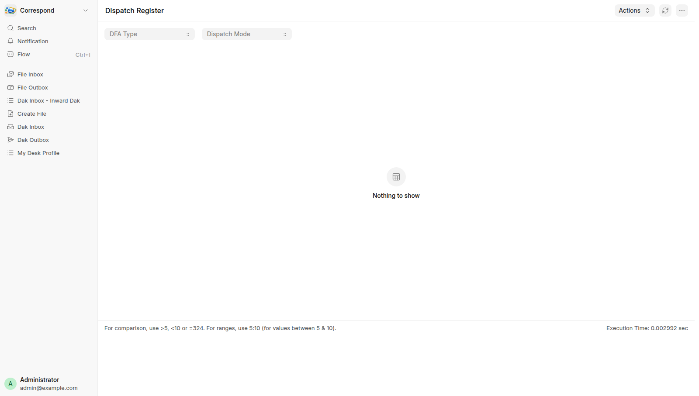

### VIP & Priority Reference Tracker
Navigate to **Correspond > VIP Reference Tracker**:
- Displays countdown timers for PMO, Parliamentary, and Court notices.
- Alerts supervisory officers when an SLA target is within 24 hours of expiry.

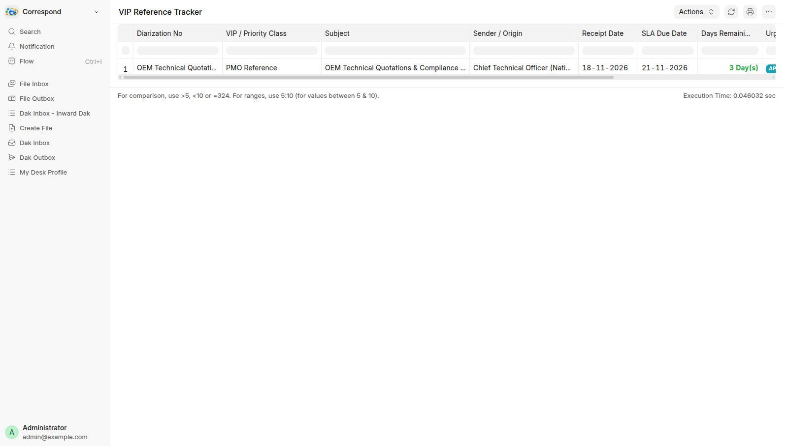

### Electronic Record Room Register
Navigate to **Correspond > Electronic Record Room**:
- Search archived records by retention category (A/B/C), closing date range, or retention expiry status.

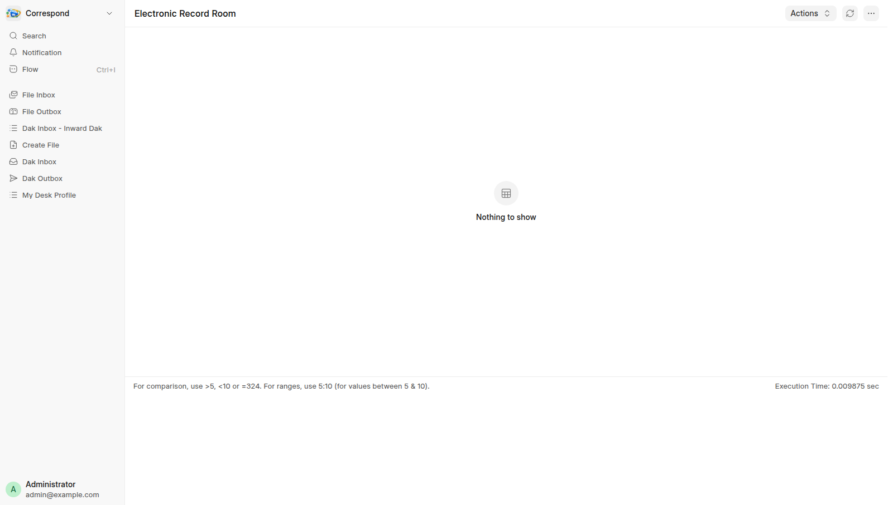

---

*Correspond Operations Manual — Version 2.0 (Post Sprints 1–4)*
